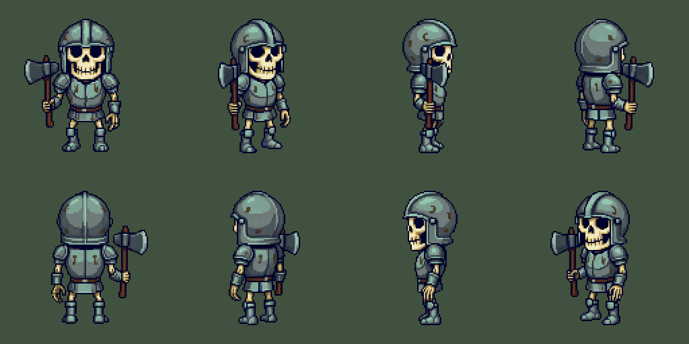
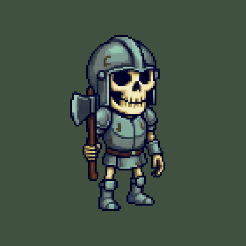

# Тест инструмента «Персонажи» — 19.09.2026

Лимит запроса пользователя: максимум 4 генерации. Не интегрировано в Unity.

## Персонаж

- `character_id`: `b168bcad-9036-449e-8538-17e63f1fc599`.
- Название в PixelLab: `Skeleton Armored Character Trial 20260919`.
- Исходник: `reference-front-128.png`, точная копия `../PoseDown-v2/frame-00.png`.
- `create_character(mode="v3", reference_image_base64=...)`, без изменения масштаба исходника.
- Стоимость создания, подтверждённая ответом: 2 генерации.
- Получены 8 ракурсов 128×128. Альфа 0/255, срезов по границе холста нет; южный ракурс совпадает по рисунку с исходником. Это новый managed character, не регистрация предыдущих самостоятельных анимаций.

Порядок: south, south-east, east, north-east; north, north-west, west, south-west.

## Тест атаки

Использован `animate_character`, режим `v3`, только `south-east`, 4 генерируемых кадра + 1 опорный. Группа: `7dc583e1-dfd7-46f0-ade0-ac08c18b4ef0`. Завершено; точный промпт, ответы и URL сохранены в [jobs.json](jobs.json).

PNG в `Attack-v1` — исходные ответы сервиса без ретуши, замены фрагментов, стабилизации головы или ног. Холст сервис увеличил до 140×140. GIF только увеличивает эти кадры nearest-neighbor и показывает их с равной задержкой 140 мс; переход с конца на начало — это повтор GIF, а не сгенерированная фаза возврата.

Визуальная оценка: глазницы значительно стабильнее предыдущей независимой переклейки, явных белых зрачков нет, голова движется вместе с телом. Однако кадр 03 содержит белую дугу, топор меняет форму и становится двусторонним; финальная поза не возвращается в начальную. Результат не принят для интеграции. Возможность managed character сама по себе не гарантирует постоянство оружия или отсутствие эффектов.

Проверены все 5 кадров: альфа 0/255, холст 140×140, нет обрезания по краям. Unity, Android и бой не проверялись — файлы остаются в `Docs/Art`.

## Фактический расход

Счётчик вырос с 142 до 144 после создания персонажа, затем до 146 после анимации. Итого использован весь бюджет 4 генерации. Ответ `animate_character` обещал 1 генерацию, но прирост счётчика для этого этапа составил 2; ориентироваться на фактический расход, не повторять обещание инструмента. Платные кредиты $0.00, покупок нет. Больше запросов генерации не выполнялось.

Голова должна двигаться вместе с телом при ударе, а не быть закреплена в экранных координатах. Запрошены неизменная анатомия черепа и пустые глазницы без век, зрачков и моргания. Кадры теста не склеивать из фрагментов и не ретушировать перед показом пользователю.

Исходные варианты в соседних папках сохранены. Предыдущий `Hit-v3` отклонён пользователем за изменение размеров глазниц; этот тест не считается его исправлением до просмотра результата.
