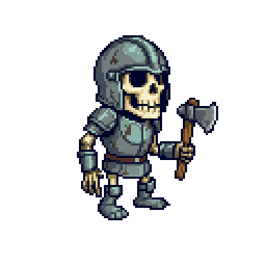
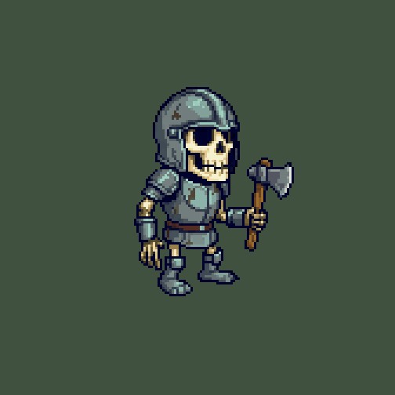
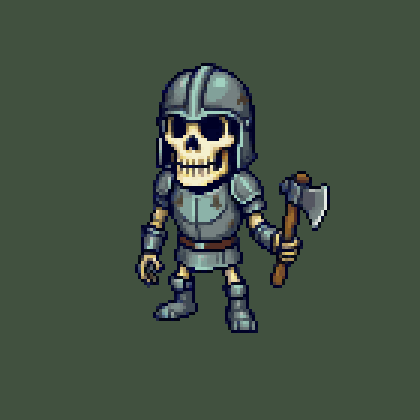
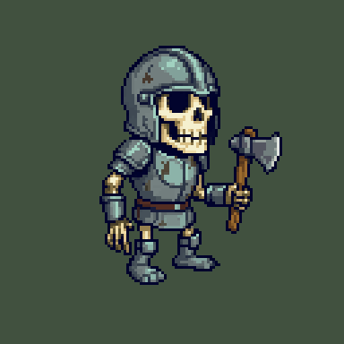

# Скелет в броне

Графика PixelLab, 12.09.2026; исправления 19.09.2026. Отдельный рабочий вариант существующего скелета; пока не интегрирован в игру.

## Полученные движения

[Продолжение 04.10.2026 с короткими промптами](CharacterTrial-20261004/README.md): кандидат смерти с распадом на кости и броню, локально убран лишний череп; чистая фаза фронтального удара без световых дуг. Полный цикл удара и естественный распад пока не закрыты. Все результаты остаются вне `Assets`.

Текущий тест: [через «Персонажей» PixelLab от нужного ракурса 3/4](CharacterTrial-20260922/README.md). Получены 8 ракурсов, сильный боковой удар с отдельным возвратом, варианты стойки и ходьбы; потрачено 15 генераций, платные кредиты не затронуты. После замечания о рывке вперёд в возврате собран `AttackCandidate-v4` без проблемного промежуточного кадра, без расхода генераций. Удар и стойка — кандидаты; ходьба и смерть остаются открытыми задачами. Это всё ещё вне игровых `Assets`; `CharacterTrial-20260919` с неверным ракурсом и белой дугой по-прежнему отклонён.

[Проба 26–27.09.2026](CharacterTrial-20260926/README.md): получены кандидаты стойки спереди и со спины и разъединённой позы смерти. Анимации смерти и направленных ударов отклонены из-за вспышек, пропадающих частей и слабого движения; не подключать их к игровому врагу. Израсходовано 15 бесплатных генераций, $0.00 платных кредитов.

Ходьба — кандидат:

Боковой удар `Hit-v3` отклонён пользователем: белые вкрапления убраны, но размер и форма глазниц меняются между кадрами. Независимые правки глаз и их перенос в кадры не обеспечили согласованную анимацию. Не использовать как исправленный финальный вариант:

Стойка `Idle-v3`: новое движение верхней части тела, нижняя часть ног закреплена исходным слоем без масштабирования. Пиксели стоп одинаковы во всех кадрах:

Ракурсы: [вниз с топором](PoseDown-v2/contact-3x.png), [строго со спины](PoseUp-v1/contact-3x.png).

В [ударе вверх v3](HitUp-v3/preview-3x.gif) удалён белый след у шлема, но слабый замах остаётся. Удар вниз пока не исправлен: `HitDown-v2` отклонён из-за формы оружия, `HitDown-v3` — из-за новых вспышек и двустороннего топора. Полноценной анимации смерти ещё нет: опорные позы не прошли весь отбор.

12.09 использованы 20 доступных генераций. 19.09 выполнены 15 заданий стоимостью 16 генераций; журнал — [repairs-20260919.json](repairs-20260919.json). Платные кредиты не пополнялись. Дальнейшие пробы удара вниз остановлены по качеству, а не после отказа по лимиту.

[Сравнение глазниц до/после](Repairs-20260919/eyes-before-after.png) · [Сравнение движения до/после](Repairs-20260919/hit-before-after.gif).

[Статусы, замечания и очередь продолжения](PLAN.md) · [Все промпты, job IDs и расходы](jobs.json).
