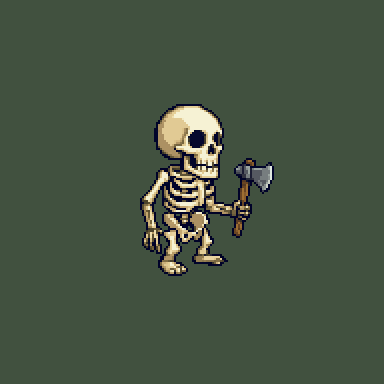

# Смерть скелета — 08.09.2026

**Отклонён пользователем:** движение похоже на добровольное приседание и укладывание. Заменён [резким распадом v2](../death-v2/README.md); файлы ниже оставлены для истории, а не описывают текущую игру.

Скелет теряет опору, падает и остаётся кучкой костей с топором. Семь уникальных кадров, без возврата в стойку. Это первая интеграционная версия смерти, не направленная атака.

## Подключение

- Production: `Assets/_IdleTowerDefense/Art/Enemies/SkeletonHatchet/Death/Skeleton_Death_00.png` … `06.png`.
- Ячейка 192×192, PPU 100, центральный pivot (0.5, 0.5), Point, без mipmaps и компрессии по умолчанию. Увеличен прозрачный холст, а не персонаж. Первый кадр — исходный утверждённый спрайт 96×96, дополненный полями по 48 пикселей.
- `Animations/Death.anim`: смена кадров каждые 0.1 с до 0.6 с, затем удержание последней позы; без зацикливания и событий урона. Пул убирает эффект через 1 секунду игрового времени.
- `Prefabs/Enemies/Skeleton Death.prefab`: отдельный SpriteRenderer/Animator и существующая отдельная тень. Нет EnemyView и коллайдеров.
- Только `Skeleton Enemy.prefab` ссылается на новый эффект. Его смерть наследует положение, поворот, масштаб/зеркалирование и сортировку модели. Пользовательские настройки живого скелета и HP не менялись. Остальные враги сохраняют прежний эффект и время 0.7 с.
- Animator и задержка возврата в пул используют игровое время: пауза останавливает их, ускорение ускоряет. Удержание эффекта при timeScale=0 и завершение после возобновления на 2x проверены в Play Mode.

## Проверки и ограничения

Просмотрены все кадры контактного листа. У семи PNG жёсткая альфа 0/255, нет обрезания по краям холста. Первый производственный кадр заменяет слегка изменённый PixelLab кадр точной копией утверждённого исходника с прозрачными полями. `raw/` хранит неизменённую выдачу генератора.

Добавлен Edit Mode контракт отдельного префаба смерти: семь спрайтов, незамкнутый клип без боевых событий, время жизни не короче клипа и отсутствие боевых компонентов. Общее число игровых кадров в проверке центральных pivot обновлено с 38 до 45.

На момент подготовки Unity MCP не был подключён; автоматический запуск сервера был заблокирован инструментом, поэтому ассеты подготовлены по существующим сериализованным шаблонам проекта. Затем сервер подключился к правильному проекту, и проверки продолжились через MCP:

- Refresh/компиляция и импорт новых ассетов завершены. Исправлено предупреждение о несовпадении имени клипа с именем файла.
- Fast: **52/52**, включая новый контракт смерти; job `8fd6047262034269809375d5dbe685f7`.
- В Play Mode вызван реальный `EnemyView.SpawnDeathVfx()` для двух экземпляров скелета. Два вызова подряд дают ровно один эффект; позиция, поворот и масштаб совпадают с моделью, зеркальная сторона сохраняет отрицательный X; порядок отрисовки 4/6 сохранён.
- Animator достигает `Skeleton_Death_06`. При timeScale=0 эффект не возвращается в пул; после возобновления на 2x возвращается. Следующий вызов использует тот же экземпляр и начинает с `Skeleton_Death_00`.
- Просмотрен [кадр Unity-камеры в Play Mode](death-runtime.png), включая отдельную тень. Это изолированная проверочная площадка, а не скриншот полноценного боя.
- Временные проверочные объекты удалены, скорость восстановлена, Play Mode остановлен. Сцены не сохранялись; ошибок в Console после проверки нет.

Остаётся художественная оценка перехода из направленных атак в общую позу смерти в полном бою и проверка на Android. Отдельные смерти вверх/вниз, билды и профилирование в эту проверку не входили.

## Происхождение

- Персонаж: утверждённый `../../skeleton-hatchet-approved-96.png`; тень — существующий ассет проекта из Tiny Swords, не часть генерации.
- Конечная поза создана ImageGen по утверждённому образу: `raw/end-pose-imagegen.png`. Затем PixelLab `image_to_pixelart`, 192×192, faithful, strength 200, guidance 7, seed 143861; job `c8a13412-df76-4366-9d77-587d8b5636e4`, стоимость 1 generation.
- `pile-pixelated-raw.png` — исходный результат пикселизации. Для `end.png` удалён только ровный фон RGB 129/129/129 и конечная поза перенесена на общую линию земли y=137. `input.png` — начальная поза на таком же холсте.
- PixelLab `animate_image`: 6 новых кадров между заданными первой и последней позами, seed 143862, job `35b9cc20-cf8d-4164-9ded-df1c48db73aa`, стоимость 4 generations. Получены 7 кадров с начальным.
- Предварительная проба без заданного последнего кадра (`e470e894-d277-4c8d-a6f1-1e050eba87cc`, seed 143860, стоимость 1 generation) отклонена: скелет оставался сидеть. Она не включена в игру.

Промпт принятой анимации:

> One-shot DEATH collapse from standing skeleton to supplied flat bone pile. NOT a loop. Knees buckle, limb joints separate, ribcage drops, skull falls and tips sideways, hatchet drops and lands on right. By halfway the torso is broken and near the ground; by fifth generated frame reach final pile, then one tiny landing bounce and stop. Preserve skull/bone SIZE: standing body 86px tall, skull about 32px wide. Large 192x192 canvas is ONLY room for scattering; no enlargement or shrinking. Fixed low 3/4 view facing right, same canvas, baseline y137. Same ivory/tan palette and navy pixel outline. NO sitting upright, intact crouching body, liquid morphing, extra bones, dust, smoke, trails, shadow, blood, glow, floor, background, text or camera movement. Must end as supplied pile, never return to standing.

Фактический результат проверяется по кадрам, а не по обещаниям промпта. `death-contact-2x.png` показывает все позы; GIF намеренно повторяется для сравнения, игровой клип — нет. `death-qa.json` содержит размеры, границы и альфу исходной выдачи.
