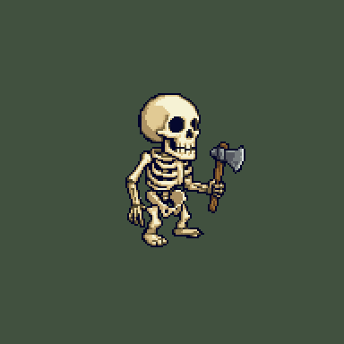

# Смерть v2 — резкий распад, 08.09.2026

Заменяет death-v1 после замечания пользователя: скелет выглядел так, будто сам приседает и ложится. Новая последовательность начинается с разъединённых костей в воздухе, а не с приседания.

## Изменения

- Семь кадров 192×192, PPU 100, центральный pivot. Первый кадр точно сохранён из утверждённого исходника; модель, тень, масштаб, HP и префабы не менялись.
- Моменты смены поз: 0 / 0.04 / 0.10 / 0.17 / 0.25 / 0.34 / 0.44 с. Разъединение видно уже на 0.04 с, кучка костей появляется на 0.25 с, окончательная поза — на 0.44 с. Затем удержание до возврата в пул через 1 с.
- Производственные PNG заменены по существующим путям `Assets/_IdleTowerDefense/Art/Enemies/SkeletonHatchet/Death/`; `.meta` и GUID сохранены. `Death.anim` изменён через Unity MCP, без правок сериализованного YAML вручную.
- Старый вариант оставлен в `../death-v1/` как отклонённый, а не удалён.

## Происхождение и отбор

Ключевая поза разъединения создана встроенным ImageGen по `../death-v1/input.png`. Исходник: `raw/burst-imagegen.png`. Постановка: одиночный кадр того же скелета в низком ракурсе 3/4 вправо; сохранить размер черепа, костей, топора, костяную палитру и тёмную обводку; мгновенно разъединить голову, рёбра, таз и конечности с прозрачными промежутками; топор выпускается из руки; без приседания, опоры на руки, новых костей, частиц, тени, текста, изменения камеры и масштаба.

PixelLab `image_to_pixelart`: 192×192, faithful=true, strength=200, guidance=7, seed=143863, job `5567e895-60de-4ae8-8156-b3feba2891b9`, 1 generation. Сгенерированная шахматная подложка удалена по светлым нейтральным цветам (min RGB > 200, диапазон каналов ≤ 6), без перекрашивания костей; весь кадр перенесён вверх на 20 пикселей. Результат: `burst.png`; сырая версия сохранена.

PixelLab `animate_image`: от `burst.png` до прежней конечной позы `../death-v1/end.png`, 6 новых кадров, seed=143864, job `492f55b5-5d1f-47f5-ad34-0a68abb49405`, 4 generations. Полная выдача сохранена в `raw/frame-00.png` … `06.png`.

Итоговый монтаж: исходная стойка → burst → raw 01 → raw 02 → raw 05 → raw 06 → заданная конечная кучка. Raw 03/04 отклонены: генератор снова частично собирал туловище и создавал подобие приседания. Это намеренный отбор поз, а не проигрывание всей выдачи подряд.

Промпт PixelLab:

> DEATH of a skeleton: start ALREADY DISASSEMBLED, all loose bones in midair. They fall under gravity and tumble into the supplied flat pile. ONE-SHOT, NEVER reconnect into a body. Frame1: skull and ribs drop, limbs rotate loosely. Frame2: everything accelerating downward, separate parts. Frame3: first bones hit ground y137, skull still falling. Frame4: skull and axe land, one tiny impact bounce. Frame5-6: scattered pile settles motionless. Preserve bone and skull sizes and palette. Camera locked, fixed ground baseline y137. No anticipation, crouching, kneeling, sitting, hands supporting body, intact torso, deliberate lying down, walking, resurrection or extra bones. No blood, dust, sparkles, smears, ghosting, background, shadow or text. Bones must FALL DOWN, not float or slowly glide. Keep original canvas size192x192 and transparent padding; no camera zoom.

## Проверки

Все семь кадров просмотрены на контактном листе; жёсткая альфа 0/255, края холста не обрезают рисунок. Технические данные: `qa.json`. В существующий контракт смерти добавлены проверки начала распада не позже 0.06 с и конечной позы не позже 0.5 с.

Unity MCP подключён к `C:/Users/tente/Desktop/The-Lone-Tower-main`, 6000.3.10f1. Импорт и компиляция завершились без ошибок. Fast **52/52**, job `b10ec44932964ad591aa36da61730d34`.

В изолированной проверке Play Mode вызван настоящий `EnemyView.SpawnDeathVfx()` с обеих сторон: масштабы ±0.6 и порядок 4/6 совпадают с моделями, повторный вызов не создаёт второй эффект. [Кадр Unity-камеры на 0.11 с](death-runtime.png) показывает разъединённые кости в обе стороны и отдельную тень. Пауза удерживает кадр 02; продвижение до 0.51 с показывает конечный кадр 06. Это проверочная площадка, а не полноценный бой; Android и переходы из всех направленных атак не проверялись.

На 2x эффект возвращается в пул; повторно берётся тот же экземпляр с начальным кадром 00. Проверочные объекты удалены, Play Mode остановлен. Хеши обоих префабов и всех семи `.png.meta` совпали с началом этой правки.

При первом переходе от Fast к Play Mode раннер Unity ещё выполнял очистку и выдал четыре служебных исключения SaveModifiedSceneTask/PostbuildCleanup/RestoreSceneSetupTask. Play Mode остановлен; отдельный повтор Fast (job `e75fa7cb1bcc4e9d8be42c7c1e6992c5`) завершился **52/52** без переключения режима во время очистки. Не исправлялся сторонний пакет и не очищалась история Console.
